<div align="center">


<br>


<br><br>


**[The AR view](#the-ar-view-design-target)** &nbsp;·&nbsp; **[See it in action](#see-it-in-action)** &nbsp;·&nbsp; **[The idea](#the-idea-strike-anticipation)** &nbsp;·&nbsp; **[How it works](#how-it-works)** &nbsp;·&nbsp; **[The kit](#the-kit)** &nbsp;·&nbsp; **[Quick start](#quick-start)** &nbsp;·&nbsp; **[Research](#research)** &nbsp;·&nbsp; **[Where things stand](#where-things-stand)** &nbsp;·&nbsp; **[Docs](#documentation-map)**

</div>

<br>

**Space Drums** turns a laptop webcam and two *ordinary* drumsticks into a playable virtual drum kit. A causal computer-vision pipeline follows your hands and the stick tips, a deterministic geometry stage decides when a tip strikes a pad, and a local sample engine plays the sound. It runs completely offline, with no sensors, no special sticks and no cloud.

It is also a research project. The question behind it:

> *Can a small causal model predict the future path of a drumstick early enough to reduce the effective action-to-sound latency compared with reactive impact detection, while keeping false positives and timing error acceptable?*

This repository holds the whole system, the evaluation machinery built to answer that question, and an honest record of what has (and has not) been measured so far.

> [!IMPORTANT]
> **Status: developer candidate.** The pipeline, calibration, overlay and evaluation machinery are implemented and tested. **Live physical acceptance (reach of all four pads, strike accuracy, a steady 30 FPS) has not passed**, no participant data has been collected yet, and **no latency-reduction claim is made anywhere**. Details are in [Where things stand](#where-things-stand).

<br>

<div align="center">
<table>
<tr>
<td align="center"><h3>24</h3><sub>gated phases<br>(00 to 23)</sub></td>
<td align="center"><h3>45</h3><sub>architecture<br>decision records</sub></td>
<td align="center"><h3>1,701</h3><sub>tests passing<br>in 28 suites</sub></td>
<td align="center"><h3>≈ 40 k</h3><sub>lines of Python<br>in <code>src/</code></sub></td>
<td align="center"><h3>7</h3><sub>enforced import<br>contracts</sub></td>
<td align="center"><h3>0</h3><sub>sensors or<br>cloud calls</sub></td>
</tr>
</table>
</div>

<br>


## The AR view (design target)

<div align="center">
</div>

> [!NOTE]
> **A concept, not a screenshot.** The photo is a design render of the experience the project is working toward, and the interface on top of it is redrawn as animated vector UI. FPS, latency, sensitivity and volume are placeholders, the hits are a scripted loop, and nothing on this picture is a measurement. What the code produces today is shown under [See it in action](#see-it-in-action).

**Try it.** Open [`docs/ui-prototype/ar-view.html`](docs/ui-prototype/ar-view.html) in a browser (one file, no server, no network). Click a drum or press **1** to **4** to strike it with the project's recorded TR-505 samples, press **Space** for a groove, drag the *Sensitivity* and *Volume* sliders, and open the camera menu and the settings panel. It is a design prototype: no camera, no tracking and no decision code.

<details>
<summary><b>What moves in this picture</b></summary>

<br>

| Part | Motion |
|---|---|
| **Drums** | Every strike sends two rings, a colour flash and a burst of sparks out of the struck drum, and its label glows. Crash and Ride ring out longer than the rest. |
| **Sticks** | The tip orbs pulse and ping on their hand's strikes, swish trails run behind them, and the hand-detection brackets breathe. |
| **Stick Tracking** | Each stick sways, swings on every strike of its hand, the grid scrolls behind it and the tip pings. |
| **Status panel** | The *Left Hand* and *Right Hand* dots flash on their own strikes, *Detected* pulses, the values glow. |
| **Control bar** | Slider knobs pulse, the gear turns, the camera chevron bobs and the speaker waves flicker. |
| **Scene** | A scan sweep crosses the picture, dust drifts through the light and the title shimmers. |

The scene is a scripted 12-second loop at 100 BPM (right hand hi-hat and snare, left hand crash and tom). It is rebuilt from the concept render by [`scripts/make_ar_ui_concept.py`](scripts/make_ar_ui_concept.py): the baked-in HUD is inpainted away and the interface is redrawn as vector UI with SMIL and CSS only, so GitHub plays it inside an ``. The prototype page is built from the same vector UI by [`scripts/make_ar_ui_prototype.py`](scripts/make_ar_ui_prototype.py), so the two cannot drift apart.

</details>


## See it in action

<div align="center">
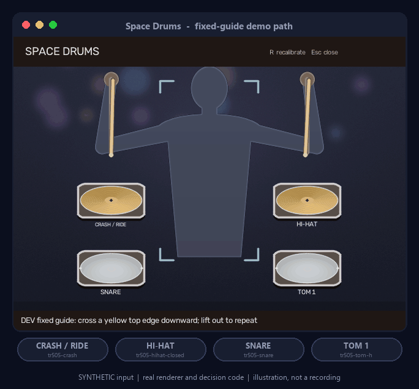
<br>
<sub><b>The kit view, driven by the real decision code.</b> Twelve scripted strokes, twelve commits, on the right pads.</sub>
</div>

<br>

> [!NOTE]
> **Every picture in this section is synthetic.** The scene is a stylised backdrop with scripted stick paths, so it is *not a recording and not evidence*. What is real: the window content is drawn by the project's own renderer (`ui.kit.render_kit`), the stick endpoints are measured on the synthetic pixels by the real `VisibleEndpointEstimator`, and every glowing chip is a commit emitted by the real `DecisionPipeline`. The window frame, chips and captions are README annotation. [How they were made](#how-these-pictures-were-made).

<div align="center">
<table>
<tr>
<td align="center" width="50%">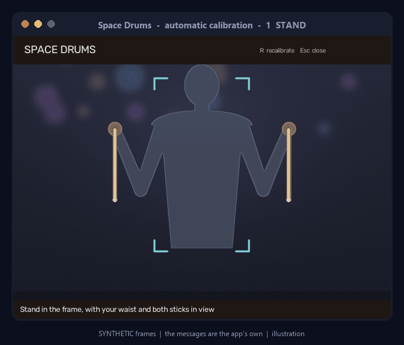<br><sub><b>Automatic calibration.</b> Stand, reach, verify, ready, with the app's own messages.</sub></td>
<td align="center" width="50%">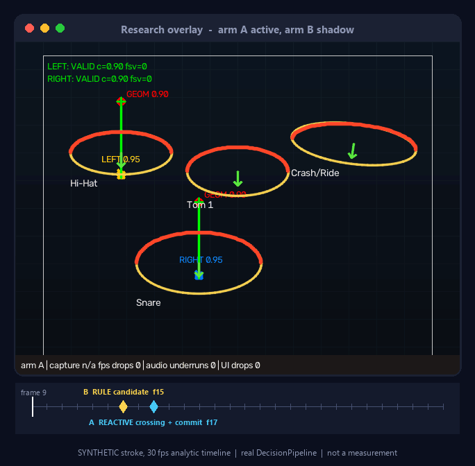<br><sub><b>Research overlay.</b> Arm B's candidate appears before arm A's crossing (synthetic stroke).</sub></td>
</tr>
</table>
</div>


## What makes it different

| Principle | In Space Drums |
|---|---|
| **Markerless** | Ordinary drumsticks. No IMUs, no ESP32, no tape required (coloured tape exists only as a labelled fallback and benchmark condition). The product path reads the visible stick endpoint from the image and never falls back to a length prior. |
| **Causal by construction** | Nothing consumes a frame newer than the one being processed. Invariance tests (`TEST-CAUSAL-1/2`) prove it instead of trusting it. |
| **Every hand is independent** | Each hand owns its tracker, kinematic state, predictor and commit state. Either hand can reach every pad. |
| **Sub-frame impact timing** | The crossing time is interpolated between the two surrounding samples instead of snapping to the nearest frame. |
| **Real recorded samples** | Seven hash-pinned drum recordings, played by a callback mixer with explicit output-latency provenance. Nothing is synthesised at run time. |
| **Offline and reproducible** | No network at run time. Model files are fetched once, hash-pinned and refused on mismatch. One monotonic clock stamps every record. |
| **Honest by design** | Every number carries a label: **Target**, **Measured**, **Historical** or **Pending**. Synthetic data is labelled synthetic, in file names too. |
| **Built to be inspected** | A scientific overlay, a dashboard, a replay viewer with ground-truth matching, and thesis-ready exports read the same immutable records. |


## The idea: strike anticipation

A camera only learns about a strike *after* it happened: the frame has to be captured, the hands found, the tip tracked and the sound scheduled. Space Drums asks whether the motion *before* the impact carries enough information to commit earlier. Not as a yes/no classifier, but **trajectory first**: predict where the tip is going, then let deterministic zone geometry decide whether that path strikes a pad.

<div align="center">
</div>

The research uses the project's canonical definitions (written once in [`phases/README.md`](phases/README.md) §5 and implemented once in the evaluation harness):

| Symbol | Meaning | Status |
|---|---|---|
| `L_sys` | Reactive action-to-sound latency: frame wait, capture, tracking, commit, audio scheduling and audio output. | **Pending** (needs an external measurement) |
| `L_pred = t_impact_est − t_commit` | Useful prediction lead time. Positive means the commit came before the estimated impact. | **Pending** (participant evaluation) |
| `L_eff ≈ max(0, L_sys − L_pred)` | Effective latency. A *conceptual* relation that motivates the work. | **Not a result.** Claimable only after Phase 18 measures it. |


## How it works

<div align="center">
</div>

<br>

One strike, end to end:

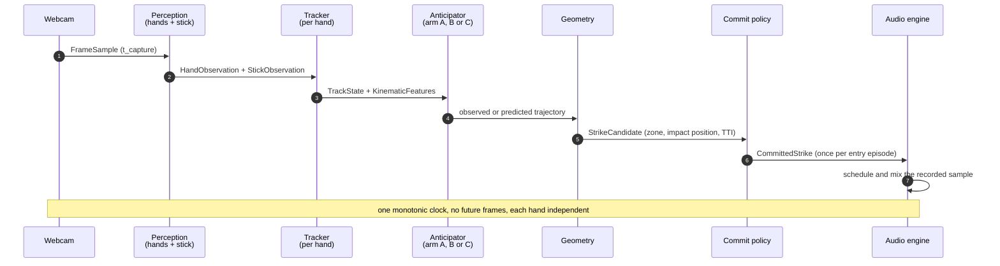

### One decision stack, several arms

Arms differ only in *where the trajectory comes from*. They share the same geometry and the same commit policy, so any difference in the results comes from the prediction and nothing else ([ADR-0008](docs/decisions/ADR-0008-candidate-source-abstraction.md)).

| Arm | Trajectory source | Where | Status |
|---|---|---|---|
| **A** | The observed path; commits after the crossing happens (reactive baseline) | Phase 05; the standing product runs this arm | Implemented |
| **B** | Causal constant-velocity / constant-acceleration extrapolation | Phase 05 | Implemented |
| **C-GBDT** | Gradient-boosted trees on windowed features (LightGBM) | Phase 09 | Implemented; participant results pending |
| **C-GRU / C-TCN** | Learned future-trajectory models, trajectory first | Phase 10 | Implemented on development data; participant results pending |
| **C-MT** | Multi-task heads: time-to-impact, zone, intensity | Phase 11 | Implemented; participant results pending |
| **C-TT** | Tiny Transformer, only if its cost is justified | Phase 12 | Optional; no extension adopted |

No winner is assumed: Phase 18 is designed so that any of A, B or C can come out best on any metric.

### Per-hand tracking safety

Each hand runs its own small state machine. By default a commit is allowed only from a fresh, confident observation (commits from `DEGRADED` are an explicit, off-by-default opt-in, [ADR-0039](docs/decisions/ADR-0039-degraded-commits.md)), and losing the hand resets the predictor instead of inventing a strike.

<div align="center">
</div>

<details>
<summary><b>From samples to a strike: the geometry rules (animated)</b></summary>

<br>

<div align="center">
</div>

</details>


## The kit

The V1 product is a **standing four-pad kit** in a clear 2×2 ([ADR-0045](docs/decisions/ADR-0045-standing-four-pad-product.md)). You stand centred in front of the webcam; the app finds your waist, asks for a few relaxed strokes at each pad and fits the four pads to *your* measured reach. Nothing asks you to drag a drum around.

<div align="center">
</div>

<br>

| Pad (display position) | Sample | Notes |
|---|---|---|
| **Crash / Ride** (upper left) | `tr505-crash` | brass-toned in the renderer |
| **Hi-Hat** (upper right) | `tr505-hihat-closed` | brass-toned in the renderer |
| **Snare** (lower left) | `tr505-snare` | |
| **Tom 1** (lower right) | `tr505-tom-h` | |

The picture on screen is mirrored (like a mirror), but ROI coordinates, zones and hand identities stay in camera space. Pads are equal rounded shapes whose top edge is the **impact surface**: a stroke counts when the tip crosses it downward. The research harness has its own layouts too, a four-zone MVP layout and a seven-zone V1 layout, under [`configs/zones/`](configs/zones/).


## Quick start

**You need:** Windows 11, 64-bit CPython **3.11** (the lock is verified for 3.11 only), a webcam, speakers or headphones, and a few GB of free disk space (PyTorch and friends are large).

```powershell
git clone https://github.com/youseffahem/air_drum_project.git
cd air_drum_project

# 1. Environment (the exact, locked dependency set)
py -3.11 -m venv .venv
.\.venv\Scripts\python.exe -m pip install --upgrade pip
.\.venv\Scripts\python.exe -m pip install -r requirements.lock
.\.venv\Scripts\python.exe -m pip install -e . --no-deps

# 2. One-time downloads: models and samples are hash-pinned and not committed
.\.venv\Scripts\python.exe scripts\fetch_hand_landmarker_model.py
.\.venv\Scripts\python.exe scripts\fetch_pose_landmarker_model.py
.\.venv\Scripts\python.exe scripts\fetch_drum_samples.py

# 3. Preflight: verifies hashes, opens neither the camera nor the speakers
.\play-spacedrums.ps1 --check
```

A healthy preflight prints (trimmed):

```json
{
  "assets": "HASH_VERIFIED",
  "samples": ["tr505-hihat-closed", "tr505-snare", "tr505-tom-h", "tr505-crash"],
  "camera_opened": false,
  "audio_opened": false,
  "live_verified": false
}
```

### Play

```powershell
.\play-spacedrums.ps1      # standing four-pad product candidate; calibrates itself on every launch
.\demo-spacedrums.ps1      # fixed-guide developer demo; bare index fingertips act as sticks
```

Stand centred with your waist and both sticks visible, hold the sticks apart for a moment, then follow the prompts: alternate your hands for six relaxed strokes at each pad. Press **R** to calibrate again and **Esc** or **Q** to close. A failed calibration keeps the sound off and tells you to retry; the app never substitutes guessed tips or an old layout.

<details>
<summary><b>Options of <code>app.play</code></b></summary>

<br>

| Flag | Effect |
|---|---|
| `--check` | Verify config, models and samples without opening any device |
| `--demo` | Explicit, uncalibrated fixed 2×2 guide with a diagnostic camera view |
| `--fingers` | Bare hands: index fingertips act as the sticks |
| `--developer` | Show developer text and write local developer logs |
| `--no-audio` | Run everything except sound output |
| `--no-window` | Headless run |
| `--replay <dir>` | Replay a recorded product session (add `--recorded-roi` for older crops) |
| `--record-frames` | Also save raw camera frames (off by default; synchronous, can lower FPS) |
| `--max-seconds N`, `--max-frames N` | Stop after a time or frame budget |
| `--output <dir>` | Write the session report here (default `data/dev-product/…`, git-ignored) |
| `--delegate CPU\|GPU` | Hand-model delegate |

Raw camera images are written only with `--record-frames`. Everything under `data/` is git-ignored, so recordings never reach the repository.

</details>

<details>
<summary><b>Research and developer commands</b></summary>

<br>

```powershell
# Research application: reactive arm active, rule-based arm logged in shadow (keys a / b switch arms)
.\.venv\Scripts\python.exe -m spacedrums.app.main --arm A --shadow B

# Deterministic SYNTHETIC scenario, no camera needed
.\.venv\Scripts\python.exe -m spacedrums.app.main --synthetic alternating_two_zones --no-audio

# Replay a recorded session with the full scientific overlay and dashboard
.\.venv\Scripts\python.exe -m spacedrums.app.main --source replay --session-dir data\dev-sessions\<id> --overlay-mode full --dashboard --no-audio

# Calibration wizard for the research layouts (see docs/user/calibration.md)
.\.venv\Scripts\python.exe -m spacedrums.app.calibrate --user-tag <nickname>
```

</details>


## Research

The thesis claim is deliberately narrow: **a measured comparison of reactive detection (A), rule-based anticipation (B) and learned anticipation (C)**, reported with its limitations. The primary figure of the project is *useful prediction lead time versus false-positive behaviour*, produced on held-out participants by sweeping the commit threshold for each arm.

<div align="center">
<table>
<tr>
<td align="center" width="50%">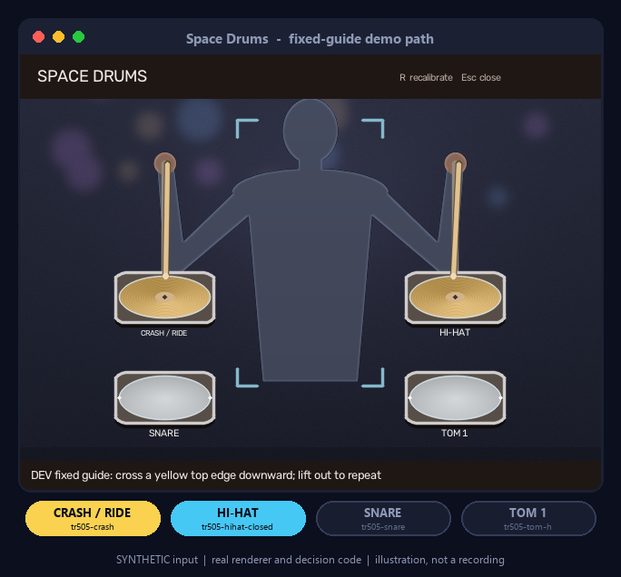<br><sub><b>Product view</b> (synthetic scene, real renderer)</sub></td>
<td align="center" width="50%">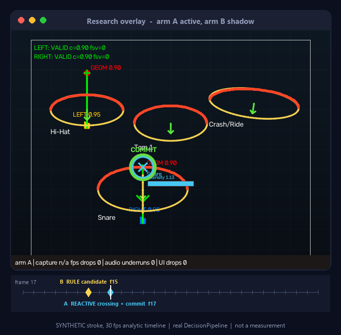<br><sub><b>Research overlay</b> (synthetic stroke, real pipeline)</sub></td>
</tr>
</table>
</div>

<br>

On that synthetic stroke, the rule-based arm's candidate appears **two frames before** the reactive crossing. That demonstrates the *mechanism*; it is an analytic path on a 30 fps timeline, not a measurement of anything a person does.

**Metrics** (defined once in the Phase 09 harness and reused unchanged afterwards): prediction lead time, false-positive and false-negative rates, signed timing error, zone accuracy, trajectory error (ADE / FDE), intensity-proxy agreement, inference latency and a full latency decomposition. Strike intensity is explicitly a *kinematic proxy*, never a force.

**The dataset plan:** about 10 to 12 participants, one or two sessions each, a structured protocol with negatives and fake-outs, participant-level splits and documented labelling rules ([`docs/dataset/`](docs/dataset/), [`docs/protocols/`](docs/protocols/), [`docs/ethics/`](docs/ethics/)). No participant recordings exist yet.

### The integrity rules

These come straight from the project requirements and are checked at every gate ([`docs/integrity-checklist.md`](docs/integrity-checklist.md)):

| Label | Meaning |
|---|---|
| **Target** | What we aim for. Never presented as a result. |
| **Measured** | Recorded with a method, a date, a hardware id and a configuration. |
| **Historical** | An earlier measurement that has been superseded. |
| **Pending** | Not measured yet. Says so, and says why. |

The project must **never** fabricate recordings, dataset samples, accuracy, latency, FPS or real-stick validation; never let a causal component read future frames; and never claim that prediction guarantees sound before the physical impact.

<details>
<summary><b>From the lab notebook: figures that already live in the repository</b></summary>

<br>

<div align="center">
<table>
<tr>
<td align="center" width="33%">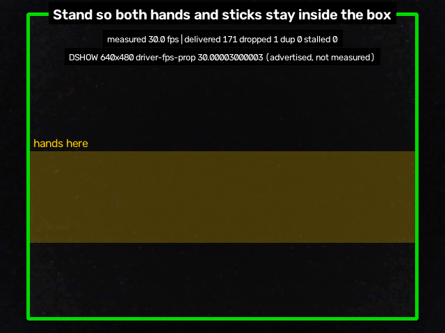<br><sub><b>Real HW-01 capture</b> (Phase 02): the stand-here guide, with the measured capture line. Dark room.</sub></td>
<td align="center" width="33%">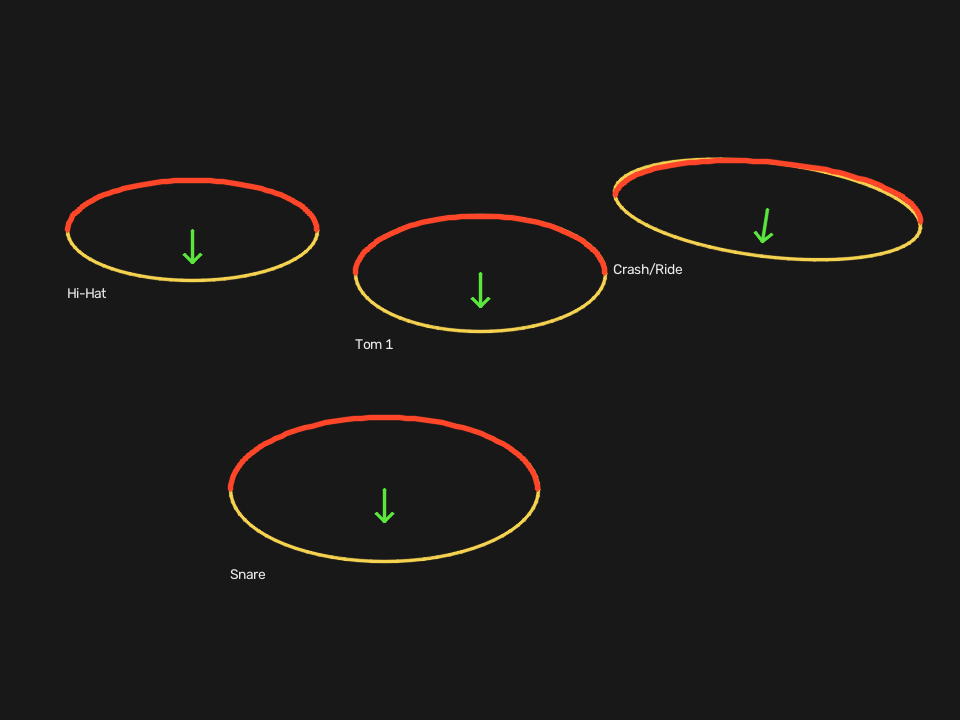<br><sub><b>MVP-4 research layout</b> (Phase 04, synthetic): impact surfaces in red, inward normals in green.</sub></td>
<td align="center" width="33%">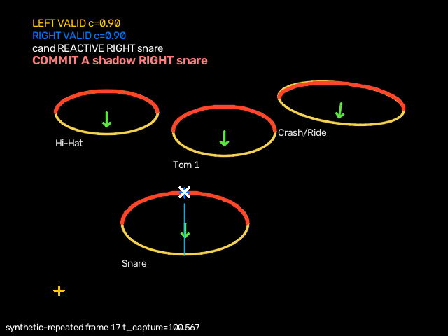<br><sub><b>First playable prototype</b> (Phase 05, synthetic): a candidate and its commit.</sub></td>
</tr>
</table>
</div>

</details>


## Where things stand

The project keeps *software status* and *evidence status* apart. Code and tests can exist long before a participant has played a note.

| Area | Status | What exists, and what is missing |
|---|---|---|
| Capture and timing (P02) | 📏 **Measured** (dev laptop) | Timestamped capture on one monotonic clock. The 640×480 mode delivered 30 FPS in the Phase 02 runs; no mode of the development webcam delivers 60 FPS. |
| Hands, stick, tracking (P03) | ✅ Implemented, gate *pass with conditions* | Three owner conditions (C-03-1/2/3) are still open. |
| Geometry and audio (P04) | ✅ Implemented, gate *proposed fail* | Audio **output latency is not measured yet**; it needs an external measurement. |
| Rule baselines, playable prototype (P05) | ✅ Implemented | Person-dependent measurements pending. |
| Data pipeline, dataset, labels (P06–P07) | ✅ Machinery · ⏳ data | No participant recordings; no split frozen. |
| Features, GBDT, evaluation harness (P08–P09) | ✅ Machinery · ⏳ results | Participant-fold results pending. |
| Temporal models, multi-task, extensions (P10–P12) | ✅ Development models · ⏳ evidence | Trained on synthetic and developer data only. None has participant evidence and none drives live anticipation in the product. |
| Live integration, calibration, dashboard (P13–P15) | ✅ Implemented · ⏳ gates | Live strokes and participant parity still required. |
| Performance, hardening (P16–P17) | ✅ Development work complete · ⏳ sign-off | Invariants I1–I6, fault injection and soak tests on synthetic strokes. |
| Evaluation, ablations (P18–P19) | ✅ Designed, pre-registered, rehearsed on synthetic data · ⏳ blocked | The confirmatory run waits for participants. |
| **Standing four-pad product** (ADR-0045) | 🚧 **Developer candidate** | Live acceptance has **not** passed. |

**Latest live developer evidence** (supervised, development laptop, 2026-10-03; details in [`docs/reports/standing-product-v1.md`](docs/reports/standing-product-v1.md)):

| | Target | Measured | Pending |
|---|---|---|---|
| Frame rate | 30 FPS | 24.78 FPS over a guided calibration run; 26.19 FPS over a fixed-guide run, idle time included | A steady 30 FPS |
| Strike path | All four pads, reliably | Two camera-driven Crash/Ride commits reached the production mixer | Four-pad recall, false and missed strikes, audibility |
| Action to sound | Measured externally | Unknown | Phase 18 |
| Lead time from prediction | Useful, with controlled false positives | Nothing on real strokes | Participant evaluation |

**Known limits.** Moving-stick endpoint support is still intermittent; stick identity through overlapping sticks is not validated; the development camera needs a manually set exposure (in dim light, automatic exposure drops it to 10 to 15 FPS); only Windows is verified (DirectShow capture); only a single user, in 2-D, with no kick pedal and no MIDI.

<br>

<div align="center">
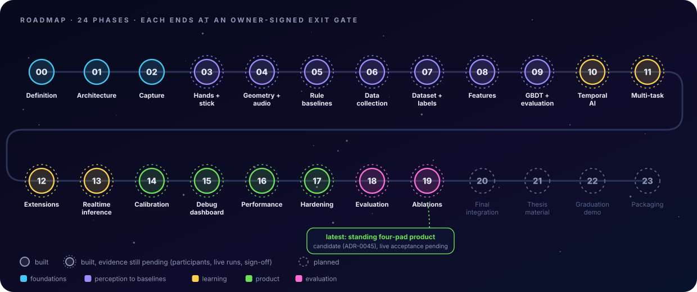
</div>

**Next:** resolve moving-stick endpoint coverage → pass live acceptance of the four-pad product → collect the participant dataset → run the pre-registered A/B/C evaluation (Phase 18) → integration, thesis material, demo and packaging (Phases 20 to 23).


## Architecture

The code is a stack of layers. A layer may import only from the layers below it, and **seven import contracts** enforce that mechanically ([`.importlinter`](.importlinter), checked by `lint-imports` and by `tests/architecture`).

<div align="center">
</div>

Three rules do the heavy lifting: **`prediction` may not import `geometry`** (a model cannot peek at the zones), **`commit` sees only `StrikeCandidate` and `TrackState`** (never perception or features), and **no causal stage may import the offline labelling code**.

<details>
<summary><b>Repository layout</b></summary>

<br>

```text
.
├── src/spacedrums/          the package (≈ 40 k lines)
│   ├── app/                 composition root: play, main, calibrate, pipeline, recorder, health, invariants
│   ├── capture/ hands/ stick/ tracking/      perception and state
│   ├── features/ prediction/ models/         kinematics, rule-based arms, GBDT / GRU / TCN
│   ├── geometry/ commit/ audio/              zones and crossings, commit policy, sample mixer
│   ├── ui/ calib/ eval/ data/                overlay and dashboard, calibration, harness, recording
│   ├── live_eval/ ablation/                  confirmatory analysis, ablation study
│   └── contracts/ timing/ config/            records, the one clock, configuration
├── configs/                 versioned YAML: product, prototype, zones, camera, calibration, schema
├── schemas/                 JSON Schemas for every record type and the experiment log
├── assets/                  hash-pinned model manifests and the drum-sample banks
├── scripts/                 one-off tools: fetch assets, measure, verify phases, render figures
├── tests/                   1,701 tests in 28 suites
├── docs/                    architecture, ADRs, gates, reports, protocols, ethics, user guides
├── phases/                  the 24-phase roadmap
├── data/ experiments/       local recordings and run outputs (git-ignored)
├── play-spacedrums.ps1      launch the standing product
└── demo-spacedrums.ps1      launch the fixed-guide developer demo
```

</details>


## Quality

```powershell
.\.venv\Scripts\python.exe -m pytest              # 1,701 passed, 1 skipped in about 13 minutes
.\.venv\Scripts\lint-imports                      # 7 import contracts: kept, 0 broken
.\.venv\Scripts\python.exe -m ruff check src tests scripts
```

The numbers above are from a full run on the development laptop on 2026-10-29 at commit `46973de` (this branch). The one skipped item is the opt-in webcam test (`SPACEDRUMS_HW_TESTS=1`).

- **Tests** cover contracts, causality (future-perturbation invariance), parity between offline replay and the live loop, failure injection, runtime invariants, geometry, audio, calibration and the UI renderers.
- **Decisions are written down.** 45 ADRs record every choice that was not in the requirements, including the ones that went against a pre-declared rule.
- **Every phase ends at a gate.** The gate record names the evidence, the open conditions and the owner's decision; code existing is never enough to pass.
- **Synthetic data is labelled** as such in file names, documents and pictures, including every animation on this page.


## Documentation map

| Read | To learn |
|---|---|
| [`project-discovery.md`](project-discovery.md) | The 60 owner-confirmed requirements and the scope rules |
| [`phases/README.md`](phases/README.md) | Roadmap, status vocabulary, timestamp and latency taxonomy, metric definitions |
| [`docs/architecture/`](docs/architecture/architecture.md) | Module map, layering, record contracts, causality tests |
| [`docs/decisions/`](docs/decisions/README.md) | The 45 architecture decision records |
| [`docs/user/standing-product.md`](docs/user/standing-product.md) | Running and validating the standing four-pad product |
| [`docs/user/calibration.md`](docs/user/calibration.md) · [`debug-overlay.md`](docs/user/debug-overlay.md) | The wizard, the overlay, the dashboard and the replay viewer |
| [`docs/reports/standing-product-v1.md`](docs/reports/standing-product-v1.md) | The latest product evidence and its limits |
| [`docs/ui-prototype/ar-view.html`](docs/ui-prototype/ar-view.html) | The clickable AR-view design prototype (open it in a browser) |
| [`docs/gates/`](docs/gates/gate-procedure.md) | One gate record per phase |
| [`docs/integrity-checklist.md`](docs/integrity-checklist.md) | The twelve integrity rules |
| [`docs/environment.md`](docs/environment.md) · [`hardware-inventory.md`](docs/hardware-inventory.md) | Locked environment and the reference laptop (HW-01) |
| [`docs/dataset/`](docs/dataset/) · [`docs/protocols/`](docs/protocols/) · [`docs/ethics/`](docs/ethics/) | Dataset cards, recording protocols, consent material |
| [`docs/perf/`](docs/perf/) · [`docs/testing/`](docs/testing/README.md) | Profiling reports, the test matrix and the failure catalogue |

<details>
<summary><b>FAQ</b></summary>

<br>

**Does it need special drumsticks?** No. Ordinary sticks, no electronics. Colour tape is only ever a fallback or a benchmark condition, and is always labelled as such.

**Will the sound play before I hit the pad?** That is the research question, and it is **not claimed**. The commit can come earlier than the observed impact only if prediction works; whether that shortens the effective latency is measured in Phase 18, with audio output latency measured externally.

**Why is the picture mirrored?** So that it behaves like a mirror. Only the camera image is mirrored; overlays are drawn afterwards in display space, text stays readable, and every coordinate used for decisions stays in camera space.

**Why only Windows and Python 3.11?** That is the verified development environment (DirectShow capture, locked wheels for MediaPipe and PyTorch). Other platforms are not verified.

**Can I use a phone or an external camera?** Not verified yet. A stronger external camera is on the wish list because the development webcam tops out at 30 FPS, but every measurement so far is from the built-in webcam of the development laptop.

**Where are the recordings?** Not in the repository. `data/` and `experiments/` are git-ignored on purpose; the manifests and split files are tracked.

</details>

<details id="how-these-pictures-were-made">
<summary><b>How these pictures were made</b></summary>

<br>

- `scripts/make_readme_assets.py` runs the project's real code on synthetic input. The kit animation scripts twelve strokes, renders synthetic pixels, measures the stick endpoints with the real endpoint estimator, runs the real decision pipeline and draws each frame with `render_kit`. The research overlay runs the analytic scenario `alternating_two_zones` through the real pipeline with arm A active and arm B in shadow. Only the MediaPipe hand model is replaced by synthetic landmarks, as in `tests/product`.
- `scripts/make_readme_svgs.py` writes the animated SVGs (SMIL and CSS only, no scripts or external files). The concept figures say so inside the picture: they are illustrations, not data. The waveforms in the kit figure are read from the recorded sample files.

```powershell
.\.venv\Scripts\python.exe scripts\make_readme_assets.py
.\.venv\Scripts\python.exe scripts\make_readme_svgs.py
```

Output goes to [`docs/assets/readme/`](docs/assets/readme/). Both scripts are deterministic: regenerating produces byte-identical files.

</details>

## Contributing

This is an academic project with a strict evidence policy, so the ground rules are short: keep `pytest` and `lint-imports` green; never let a causal component read future frames; label every number **Target**, **Measured**, **Historical** or **Pending**; and never commit recordings or participant data. Please discuss a change with the project owner before sending one.

## Acknowledgements and licences

- **Hand and pose landmarks:** [MediaPipe](https://developers.google.com/mediapipe) Hand Landmarker (Apache-2.0, per [`assets/README.md`](assets/README.md)) and Pose Landmarker models, pinned by SHA-256 in [`assets/models/manifest.json`](assets/models/manifest.json). Check the upstream model cards before redistributing the binaries.
- **Drum samples:** the runtime bank uses seven recordings of the Roland TR-505 from the [Oramics Sampled collection](https://oramics.github.io/sampled/DM/TR-505/), labelled *Public Domain* there; hashes in [`recorded-manifest.json`](assets/samples/recorded-manifest.json), provenance in [`LICENSES.md`](assets/samples/LICENSES.md). The synthetic test bank is generated by a script and dedicated to the public domain (CC0 1.0).
- **Libraries:** OpenCV, NumPy, SciPy, PyTorch, LightGBM, PyArrow, sounddevice (PortAudio), soundfile, PyYAML, jsonschema and Matplotlib, each under its own licence ([`docs/environment.md`](docs/environment.md) lists them).
- **This repository:** proprietary graduation project (see `pyproject.toml`); no open-source licence has been granted.
- **Project owner:** Youssef Fahem Amin. The git history lists every contributor.

<br>

<div align="center">

</div>
