<div align="center">


<br>


<br><br>


**[See it in action](#see-it-in-action)** &nbsp;·&nbsp; **[The AR view](#the-ar-view)** &nbsp;·&nbsp; **[The kits](#the-kits)** &nbsp;·&nbsp; **[What to download](#what-you-need-to-download)** &nbsp;·&nbsp; **[Install](#install)** &nbsp;·&nbsp; **[Run](#run-it)** &nbsp;·&nbsp; **[How it works](#how-it-works)** &nbsp;·&nbsp; **[Research](#research)** &nbsp;·&nbsp; **[Results](#results-and-limits)** &nbsp;·&nbsp; **[Docs](#documentation-map)**

</div>

<br>

**Space Drums** turns a laptop webcam into a playable virtual drum kit. Play with your **bare fingertips**, with **ordinary drumsticks**, or with **red-tipped sticks**, on a calibrated four-pad kit or a full **seven-piece kit**, in a classic stage view or a GPU-rendered **AR view** that draws the drums into the live camera picture. A causal computer-vision pipeline follows your hands and the tips, a deterministic geometry stage decides when a tip strikes a pad, and a local sample engine plays real drum recordings. It runs completely offline, with no sensors, no special hardware and no cloud.

It is also a research project. The question behind it:

> *Can a small causal model predict the future path of a drumstick early enough to reduce the effective action-to-sound latency compared with reactive impact detection, while keeping false positives and timing error acceptable?*

This repository is the **final release** of the project: the playable application, the evaluation machinery built to answer that question, and an honest record of what was measured.

> [!NOTE]
> **Final release.** All 20 phases (00 to 19) were delivered with code, tests and a gate record. The application, its three play modes, its three kits, both views, the calibration, the overlays and the evaluation harness are complete. The research comparison was designed, pre-registered and rehearsed on synthetic data; it was not run with participants, so **no latency-reduction claim is made anywhere**. See [Results and limits](#results-and-limits).

<br>

<div align="center">
<table>
<tr>
<td align="center"><h3>20</h3><sub>phases delivered<br>(00 to 19)</sub></td>
<td align="center"><h3>50</h3><sub>architecture<br>decision records</sub></td>
<td align="center"><h3>{{TESTS}}</h3><sub>tests passing<br>in 28 suites</sub></td>
<td align="center"><h3>≈ 47 k</h3><sub>lines of Python<br>in <code>src/</code></sub></td>
<td align="center"><h3>7</h3><sub>enforced import<br>contracts</sub></td>
<td align="center"><h3>0</h3><sub>sensors or<br>cloud calls</sub></td>
</tr>
</table>
</div>

<br>


## See it in action

<div align="center">
<table>
<tr>
<td align="center" width="50%">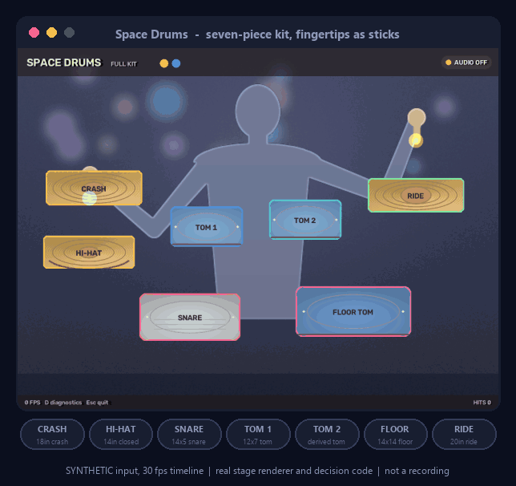<br><sub><b>Fingertips</b> (<code>fingers.bat</code>, <code>--fingers</code>). Sixteen scripted strokes, sixteen commits, every one on the right piece.</sub></td>
<td align="center" width="50%">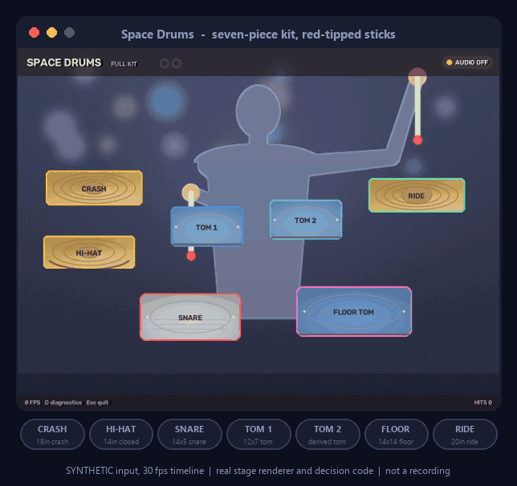<br><sub><b>Red-tipped sticks</b> (<code>sticks.bat</code>, <code>--red-tips</code>). Sixteen scripted strokes, sixteen commits, every one on the right piece.</sub></td>
</tr>
</table>
<sub><b>The seven-piece kit, driven by the real decision code.</b> The stage, its flashes, ripples, sparks, trails and combo counter are drawn by the app's own renderer.</sub>
</div>

<br>

> [!NOTE]
> **Every animation in this section is synthetic.** The scenes are a stylised backdrop with scripted fingertip and stick paths and scripted key presses, so they are *not recordings and not evidence*. What is real: the window content is drawn by the project's own renderers (`ui.stage.StageRenderer`, `ui.layout_preview.LayoutPreview`, the research overlay), the fingertips are read by the real fingertip estimator, the red tips are found in the synthetic pixels by the real red-tip detector, and every flash and glowing chip is a commit emitted by the real `DecisionPipeline`. The frame rate in the stage header is the synthetic 30 fps timeline. [How they were made](#how-these-pictures-were-made).

<div align="center">
<table>
<tr>
<td align="center" width="50%">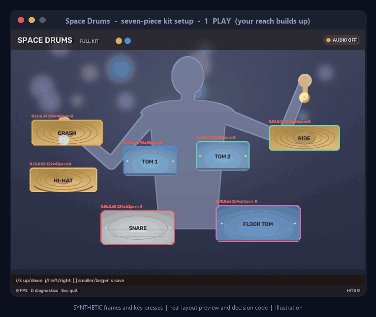<br><sub><b>Fit the kit to you</b> (<code>--layout-preview</code>). Play, then move, scale and save the kit; the coordinates, reach boxes and messages are the app's own.</sub></td>
<td align="center" width="50%">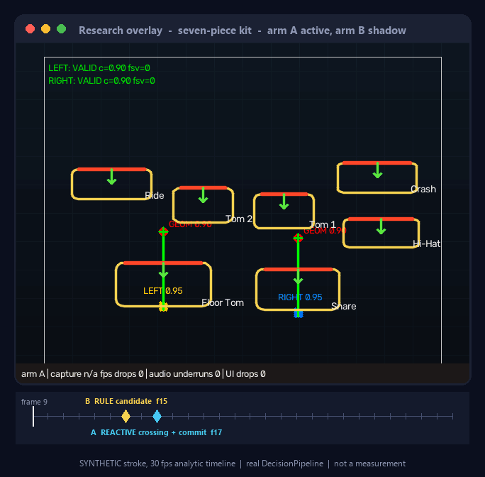<br><sub><b>Research overlay.</b> On the seven-piece kit, arm B's candidate appears before arm A's crossing (synthetic stroke).</sub></td>
</tr>
</table>
</div>


## The AR view

`--view ar` renders a 3D drum kit with the GPU (OpenGL 3.3 through `moderngl`) and composites it into the live, mirrored webcam picture, with a status card, a stick-tracking panel and a control bar ([ADR-0049](docs/decisions/ADR-0049-ar-view-gpu-kit.md)). The drums are lacquered shells, chrome hardware and brass cymbals with a neon glow, and every committed hit flashes the piece and throws sparks.

<div align="center">
</div>

> [!NOTE]
> **The design reference, not a screenshot.** This picture is the concept render the AR view was built from, with its interface redrawn as animated vector UI. The numbers on it (FPS, latency, sensitivity, volume) are placeholders and the hits are a scripted loop. The running AR view draws the same layout over *your* camera, with live values.

- **The hit zones drive the drawing.** Each drum's rim is solved in 3D so that it spans the zone's strike line exactly, so what you see is what you hit. The renderer never moves a zone.
- **Sound comes first.** The audio for a hit is scheduled before anything is drawn, so the view can delay the next frame but never the current hit.
- **It cannot break the session.** Without a usable OpenGL 3.3 driver (or without `moderngl`), the app prints one line and continues in the classic view.
- **The control bar works with the mouse or the keyboard:** settings, camera viewpoint and device, sensitivity and volume (see [Controls](#controls)).

**Try the design prototype.** Open [`docs/ui-prototype/ar-view.html`](docs/ui-prototype/ar-view.html) in a browser (one file, no server, no network). Click a drum or press **1** to **4** to strike it with the project's recorded TR-505 samples, press **Space** for a groove, drag the sliders and open the menus. It has no camera and no tracking; it is the interface on its own.

<details>
<summary><b>What moves in the design reference</b></summary>

<br>

| Part | Motion |
|---|---|
| **Drums** | Every strike sends two rings, a colour flash and a burst of sparks out of the struck drum, and its label glows. Crash and Ride ring out longer than the rest. |
| **Sticks** | The tip orbs pulse and ping on their hand's strikes, swish trails run behind them, and the hand-detection brackets breathe. |
| **Stick Tracking** | Each stick sways, swings on every strike of its hand, the grid scrolls behind it and the tip pings. |
| **Status panel** | The *Left Hand* and *Right Hand* dots flash on their own strikes, *Detected* pulses, the values glow. |
| **Control bar** | Slider knobs pulse, the gear turns, the camera chevron bobs and the speaker waves flicker. |
| **Scene** | A scan sweep crosses the picture, dust drifts through the light and the title shimmers. |

The scene is a scripted 12-second loop at 100 BPM (right hand hi-hat and snare, left hand crash and tom). It is rebuilt from the concept render by [`scripts/make_ar_ui_concept.py`](scripts/make_ar_ui_concept.py): the baked-in HUD is inpainted away and the interface is redrawn as vector UI with SMIL and CSS only, so GitHub plays it inside an ``. The prototype page is built from the same vector UI by [`scripts/make_ar_ui_prototype.py`](scripts/make_ar_ui_prototype.py), so the two cannot drift apart.

</details>


## What makes it different

| Principle | In Space Drums |
|---|---|
| **No special hardware** | One webcam. Play with bare fingertips, ordinary drumsticks (the visible stick end is read from the image, never guessed from a length prior), or sticks with red-painted tips (a labelled colour-marker mode). No IMUs, no ESP32, no electronics. |
| **Causal by construction** | Nothing consumes a frame newer than the one being processed. Invariance tests (`TEST-CAUSAL-1/2`) prove it instead of trusting it. |
| **Every hand is independent** | Each hand owns its tracker, kinematic state, predictor and commit state. Either hand can reach every pad. |
| **Sub-frame impact timing** | The crossing time is interpolated between the two surrounding samples instead of snapping to the nearest frame. |
| **Real recorded samples** | An acoustic seven-piece bank (the Salamander Drumkit) and a TR-505 drum-machine bank, hash-pinned and played by a callback mixer with explicit output-latency provenance. Nothing is synthesised at run time. |
| **Offline and reproducible** | No network at run time. Models and samples are fetched once, hash-pinned and refused on mismatch. One monotonic clock stamps every record. |
| **Honest by design** | Every number carries a label: **Target**, **Measured**, **Historical** or **Pending**. Synthetic data is labelled synthetic, in file names too. |
| **Built to be inspected** | A scientific overlay, a diagnostic view, a dashboard, a replay viewer with ground-truth matching, and thesis-ready exports read the same immutable records. |


## The kits

There are three kits. Each pad is a shape whose top edge (or head line) is the **impact surface**: a stroke counts when the tip crosses it downward, once per stroke.

| Kit | Pieces | Sound bank | Used by |
|---|---|---|---|
| **Seven-piece kit** | Crash, Ride, Hi-Hat, Snare, Tom 1, Tom 2, Floor Tom (no kick) | Acoustic **Salamander Drumkit** | `--demo` (default `--kit full`), `fingers.bat`, `sticks.bat` |
| **Reference four-piece kit** | Crash / Ride high left, Hi-Hat high right, Tom and Snare low in the middle | TR-505 | the AR view's default (`--kit reference`), calibrated or fixed |
| **Standing four-pad kit** | Crash / Ride, Hi-Hat, Snare, Tom 1 in a clear 2×2 | TR-505 | calibrated classic play (`play-spacedrums.ps1`), `--kit four` |

<div align="center">
</div>

<br>

<details>
<summary><b>The seven-piece kit, piece by piece</b></summary>

<br>

The pieces are arranged as a drummer sees them from the seat ([`configs/demo.fullkit.candidate.yaml`](configs/demo.fullkit.candidate.yaml), the same file the picture above is drawn from): cymbals wide and shallow, drums deeper, the snare and floor tom the largest close targets.

| Piece | Where (as displayed) | Sample |
|---|---|---|
| **Crash** | high, left | Paiste 18" crash |
| **Ride** | high, right | 20" ride |
| **Hi-Hat** | left, in front of the snare | Stagg 14" hi-hat, closed |
| **Tom 1** | above the snare | 12×7" rack tom |
| **Tom 2** | right of Tom 1, a little higher | the rack tom transposed down 6 semitones (labelled *derived*) |
| **Snare** | low, centre-left | 14×5" birch snare |
| **Floor Tom** | low, right, the largest drum | 14×14" floor tom |

Each piece has a hard and a soft layer with up to three round-robin takes. Not happy with where the pads sit? `--layout-preview` shows each pad's coordinates and your measured reach; **i / k / j / l** move the kit, **[ ]** scale it, **s** saves `kit-layout.yaml`, and `--kit-layout <file>` plays it later.

</details>

The calibrated four-pad kit fits itself to *you*: you stand centred, the app finds your waist, asks for a few relaxed strokes at each pad and places the pads at your measured reach ([ADR-0045](docs/decisions/ADR-0045-standing-four-pad-product.md), [ADR-0050](docs/decisions/ADR-0050-reference-kit-arrangement.md)). The picture on screen is mirrored, but ROI coordinates, zones and hand identities stay in camera space. The research harness has its own layouts too (a four-zone MVP layout and a seven-zone V1 layout) under [`configs/zones/`](configs/zones/).


## What you need to download

**Hardware:** a Windows 11 PC (64-bit), a webcam (the built-in one is fine), and speakers or headphones. A GPU driver with **OpenGL 3.3** is needed only for the AR view; without it the classic view is used. For the red-tip mode, paint the tips of two drumsticks red.

**Software you install yourself:**

| Tool | Version | Why | Get it |
|---|---|---|---|
| **Git** | any recent | to clone the repository | [git-scm.com/download/win](https://git-scm.com/download/win) |
| **Python** | **3.11**, 64-bit (CPython) | the only version the locked dependency set is verified for | [python.org/downloads/windows](https://www.python.org/downloads/windows/) (tick *"py launcher"* and *"Add python.exe to PATH"*) |
| **Microsoft Visual C++ Redistributable** | 2015 to 2022, x64 | runtime for the LightGBM, PyTorch and OpenCV wheels; already present on most Windows 10/11 machines | [learn.microsoft.com/cpp/windows/latest-supported-vc-redist](https://learn.microsoft.com/cpp/windows/latest-supported-vc-redist) |
| **Graphics driver** | with OpenGL 3.3 | the AR view only | your GPU vendor (Intel, NVIDIA or AMD) or Windows Update |

**Installed for you by the commands below** (internet needed once, then never again):

| What | Size (approx.) | Fetched by |
|---|---|---|
| Python packages: NumPy, SciPy, OpenCV, MediaPipe, PyTorch (CPU), LightGBM, moderngl, sounddevice, … (60 pinned packages) | a few GB | `pip install -r requirements.lock` |
| MediaPipe Hand Landmarker model | 7.8 MB | `scripts\fetch_hand_landmarker_model.py` |
| MediaPipe Pose Landmarker model (calibrated play) | 9.4 MB | `scripts\fetch_pose_landmarker_model.py` |
| TR-505 drum-machine samples (four-pad kits) | 0.3 MB | `scripts\fetch_drum_samples.py` |
| Salamander Drumkit archive (seven-piece kit) | 388 MB download, 25 MB kept | `scripts\fetch_acoustic_samples.py` |

Every model and sample is pinned by its SHA-256 hash and refused if it does not match. Plan for a few GB of free disk space.


## Install

Open **PowerShell** and run, one block at a time:

```powershell
# 1. Get the code
git clone https://github.com/youseffahem/air_drum_project.git
cd air_drum_project

# 2. Create the environment and install the exact, locked dependency set
py -3.11 -m venv .venv
.\.venv\Scripts\python.exe -m pip install --upgrade pip
.\.venv\Scripts\python.exe -m pip install -r requirements.lock
.\.venv\Scripts\python.exe -m pip install -e . --no-deps

# 3. One-time downloads: models and samples (hash-pinned, not stored in git)
.\.venv\Scripts\python.exe scripts\fetch_hand_landmarker_model.py
.\.venv\Scripts\python.exe scripts\fetch_pose_landmarker_model.py
.\.venv\Scripts\python.exe scripts\fetch_drum_samples.py
.\.venv\Scripts\python.exe scripts\fetch_acoustic_samples.py

# 4. Check: verifies every hash, opens neither the camera nor the speakers
.\.venv\Scripts\python.exe -m spacedrums.app.play --demo --kit full --check
```

A healthy check prints (trimmed):

```json
{
  "assets": "HASH_VERIFIED",
  "samples": ["salamander-crash", "salamander-ride", "salamander-tom1", "salamander-tom2",
              "salamander-hihat", "salamander-snare", "salamander-floor-tom"],
  "camera_opened": false,
  "audio_opened": false,
  "live_verified": false
}
```


## Run it

Double-click a shortcut in the project folder, or run it from PowerShell in that folder:

| Shortcut | What you get |
|---|---|
| **`fingers.bat`** | Seven-piece kit in the AR view, **fingertips** as sticks |
| **`sticks.bat`** | Seven-piece kit in the AR view, **red-tipped drumsticks** |
| `.\play-spacedrums.ps1` | Standing four-pad kit with ordinary sticks; calibrates itself on every launch (classic view) |
| `.\play-ar-spacedrums.ps1` | The AR view with the reference four-piece kit, calibrated; add `--demo --fingers` for a fixed kit and fingertips |
| `.\demo-spacedrums.ps1` | Seven-piece kit in the classic stage view, fingertips as sticks |
| `.\demo-sticks-spacedrums.ps1` | Seven-piece kit in the classic stage view, red-tipped drumsticks |

Every shortcut passes extra options through, for example `fingers.bat --no-audio` or `.\play-spacedrums.ps1 --developer`. The same runs without shortcuts:

```powershell
.\.venv\Scripts\python.exe -m spacedrums.app.play --view ar --demo --kit full --fingers    # = fingers.bat
.\.venv\Scripts\python.exe -m spacedrums.app.play --view ar --demo --kit full --red-tips   # = sticks.bat
.\.venv\Scripts\python.exe -m spacedrums.app.play                                         # = play-spacedrums.ps1
```

> [!TIP]
> If PowerShell refuses a `.ps1` file ("running scripts is disabled on this system"), allow local scripts once with `Set-ExecutionPolicy -Scope CurrentUser RemoteSigned`, or use the `.bat` shortcuts, which need no policy change.

**How to play.** Stand (or sit) centred in front of the webcam with both hands in view. Strike *down* through a pad's top edge (or a drum's head line in the AR view), then lift out to play it again. In calibrated play, hold the sticks apart for a moment, then follow the prompts: alternate your hands for six relaxed strokes at each pad. A failed calibration keeps the sound off and tells you to retry; the app never substitutes guessed tips or an old layout.

### Controls

| Key | Where | Action |
|---|---|---|
| **Esc** or **Q** | everywhere | quit (in the AR view, Esc first closes an open menu) |
| **R** | calibrated play | calibrate again |
| **D** | seven-piece stage, AR view | toggle the diagnostic view (tips, candidates, strike state) |
| **S** | AR view | open or close the settings menu |
| **H / T / E / B / G** | AR view | toggle the panels, trails, hit effects, glow, see-through kit |
| **C** | AR view | open or close the camera menu (viewpoint or camera device) |
| **V** | AR view | cycle the viewpoint: Front, High Angle, Low Angle |
| **[** and **]** | AR view | sensitivity down / up (0.7 = the tested stroke-speed threshold) |
| **-** and **=** | AR view | volume down / up (0.8 = the normal level) |
| **A** | AR view | back from the classic view |
| **i / k / j / l**, **[ ]**, **s** | `--layout-preview` | move, scale and save the seven-piece kit |

<details>
<summary><b>All options of <code>app.play</code></b></summary>

<br>

| Flag | Effect |
|---|---|
| `--check` | Verify config, models and samples without opening any device |
| `--view classic\|ar` | Classic views (default) or the GPU-rendered AR view |
| `--demo` | Uncalibrated fixed kit (the seven-piece kit by default) |
| `--kit full\|four\|reference` | Seven-piece kit, the 2×2 guide, or the reference four-piece arrangement (default: `full`, or `reference` with `--view ar`) |
| `--fingers` | Bare hands: index fingertips act as the sticks |
| `--red-tips` | Sticks with red-painted tips, tracked by colour (a labelled marker mode) |
| `--hand-assist` | With `--red-tips`: also run the hand model to label new tips (about 27 ms per frame) |
| `--stick-tip-config <yaml>` | With `--red-tips`: override the tip settings |
| `--layout-preview` | With `--demo --kit full`: show pad coordinates and your measured reach; move, scale, save |
| `--kit-layout <yaml>` | With `--demo --kit full`: play a layout saved by `--layout-preview` |
| `--camera native\|standard` | Native 1280×720 capture with the same tracking frame (default), or the previous 640×480 mode |
| `--camera-index N` | Open camera device N |
| `--exposure auto\|VALUE` | Override the camera exposure (DirectShow log2; `-5` = 31 ms, the longest that keeps 30 FPS on the built-in webcam) |
| `--preview natural\|raw\|legacy` | Display look only: natural brightness (default), raw camera pixels, or the previous dimmed look |
| `--tracking-tone off\|auto` | Opt-in: brighten the frames the hand model sees |
| `--exclusive-audio` | WASAPI exclusive mode: about 5 ms output instead of about 22 ms, but other apps lose sound |
| `--delegate CPU\|GPU` | Hand-model delegate |
| `--developer` | Show developer text and write local developer logs |
| `--no-audio` · `--no-window` | Run without sound output · without a window |
| `--replay <dir>` | Replay a recorded session (add `--recorded-roi` for older crops) |
| `--record-frames` | Also save raw camera frames (off by default; synchronous, can lower FPS) |
| `--max-seconds N` · `--max-frames N` | Stop after a time or frame budget |
| `--output <dir>` | Write the session report here (default `data/dev-product/…`, git-ignored) |

Raw camera images are written only with `--record-frames`. Everything under `data/` is git-ignored, so recordings never reach the repository.

</details>

<details>
<summary><b>Troubleshooting</b></summary>

<br>

| Symptom | Fix |
|---|---|
| The AR view does not open; the console says `no OpenGL context; using the classic view` | `moderngl` is missing or the driver lacks OpenGL 3.3. Re-run `pip install -r requirements.lock` and update the graphics driver. |
| `--check` reports a missing or mismatched file | Run the matching `fetch_…` script again; a file with a wrong hash is always refused. |
| The picture is dark or the frame rate drops to 10 to 15 FPS | Automatic exposure lengthened the shutter. Opening the Windows Camera app switches the webcam to automatic exposure, and it can stay there after that app closes. The default capture watches the frame rate and sets a fixed exposure again; you can also pass `--exposure -5` or add light. |
| The wrong camera opens | Pass `--camera-index 1` (or 2, …), or pick the device from the AR view's camera menu. |
| No sound | Check that the output device works in Windows, and that `--check` lists the samples. `--exclusive-audio` needs a device that other apps are not using. |
| Strikes are missed or doubled | Strike *down through* the edge and lift fully out before the next stroke; keep both hands inside the picture. In the AR view, adjust *Sensitivity*. |

</details>

<details>
<summary><b>Research and developer commands</b></summary>

<br>

```powershell
# Research application: reactive arm active, rule-based arm logged in shadow (keys a / b switch arms)
.\.venv\Scripts\python.exe -m spacedrums.app.main --arm A --shadow B

# Deterministic SYNTHETIC scenario, no camera needed
.\.venv\Scripts\python.exe -m spacedrums.app.main --synthetic alternating_two_zones --no-audio

# Replay a recorded session with the full scientific overlay and dashboard
.\.venv\Scripts\python.exe -m spacedrums.app.main --source replay --session-dir data\dev-sessions\<id> --overlay-mode full --dashboard --no-audio

# Calibration wizard for the research layouts (see docs/user/calibration.md)
.\.venv\Scripts\python.exe -m spacedrums.app.calibrate --user-tag <nickname>
```

</details>


## The idea: strike anticipation

A camera only learns about a strike *after* it happened: the frame has to be captured, the hands found, the tip tracked and the sound scheduled. Space Drums asks whether the motion *before* the impact carries enough information to commit earlier. Not as a yes/no classifier, but **trajectory first**: predict where the tip is going, then let deterministic zone geometry decide whether that path strikes a pad.

<div align="center">
</div>

The research uses the project's canonical definitions (written once in [`phases/README.md`](phases/README.md) §5 and implemented once in the evaluation harness):

| Symbol | Meaning | Status |
|---|---|---|
| `L_sys` | Reactive action-to-sound latency: frame wait, capture, tracking, commit, audio scheduling and audio output. | Not measured externally in this release |
| `L_pred = t_impact_est − t_commit` | Useful prediction lead time. Positive means the commit came before the estimated impact. | Not measured on participants in this release |
| `L_eff ≈ max(0, L_sys − L_pred)` | Effective latency. A *conceptual* relation that motivates the work. | **Not a result.** Claimable only from the Phase 18 measurement. |


## How it works

<div align="center">
</div>

<br>

One strike, end to end:

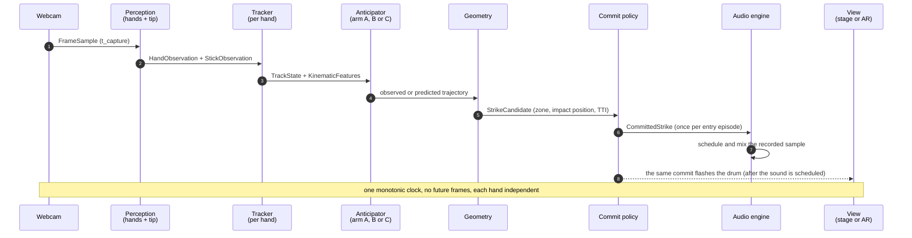

**Three ways to find the tip, one decision stack.** The visible-endpoint estimator reads the end of an ordinary stick from the image; the fingertip estimator uses the index fingertip of the hand model; the red-tip tracker follows two painted caps by colour, with its own per-tip tracks ([ADR-0046](docs/decisions/ADR-0046-red-tip-marker-stick-mode.md)). All three hand the same records to the same geometry, commit policy and audio engine.

### One decision stack, several arms

Arms differ only in *where the trajectory comes from*. They share the same geometry and the same commit policy, so any difference in the results comes from the prediction and nothing else ([ADR-0008](docs/decisions/ADR-0008-candidate-source-abstraction.md)).

| Arm | Trajectory source | Where | Status |
|---|---|---|---|
| **A** | The observed path; commits after the crossing happens (reactive baseline) | Phase 05; the application runs this arm | Implemented |
| **B** | Causal constant-velocity / constant-acceleration extrapolation | Phase 05 | Implemented |
| **C-GBDT** | Gradient-boosted trees on windowed features (LightGBM) | Phase 09 | Implemented; exercised on synthetic data |
| **C-GRU / C-TCN** | Learned future-trajectory models, trajectory first | Phase 10 | Implemented; trained on synthetic and developer data |
| **C-MT** | Multi-task heads: time-to-impact, zone, intensity | Phase 11 | Implemented; trained on synthetic and developer data |
| **C-TT** | Tiny Transformer, only if its cost is justified | Phase 12 | Evaluated as an optional extension; not adopted |

No winner is assumed: Phase 18 is designed so that any of A, B or C can come out best on any metric.

### Per-hand tracking safety

Each hand runs its own small state machine. By default a commit is allowed only from a fresh, confident observation (commits from `DEGRADED` are an explicit, off-by-default opt-in, [ADR-0039](docs/decisions/ADR-0039-degraded-commits.md)), and losing the hand resets the predictor instead of inventing a strike.

<div align="center">
</div>

<details>
<summary><b>From samples to a strike: the geometry rules (animated)</b></summary>

<br>

<div align="center">
</div>

</details>

<details>
<summary><b>Camera and display</b></summary>

<br>

- **Native capture** ([ADR-0047](docs/decisions/ADR-0047-native-capture-hd-preview.md)): the webcam's 1280×720 mode is captured, the tracker sees the same 640×480 field of view as before, and the window shows it at full detail. If the mode is not delivered, the app falls back to 640×480 and says so.
- **Brightness** ([ADR-0048](docs/decisions/ADR-0048-camera-brightness.md)): the preview is shown at a natural brightness (display only, never the tracking frame), and a measured exposure guard keeps the webcam at 30 FPS.
- **Mirroring:** only the picture is mirrored. Overlays are drawn afterwards in display space, text stays readable, and every coordinate used for decisions stays in camera space.

</details>


## Research

The thesis claim is deliberately narrow: **a measured comparison of reactive detection (A), rule-based anticipation (B) and learned anticipation (C)**, reported with its limitations. The primary figure of the project is *useful prediction lead time versus false-positive behaviour*, produced on held-out participants by sweeping the commit threshold for each arm.

<div align="center">
<table>
<tr>
<td align="center" width="50%">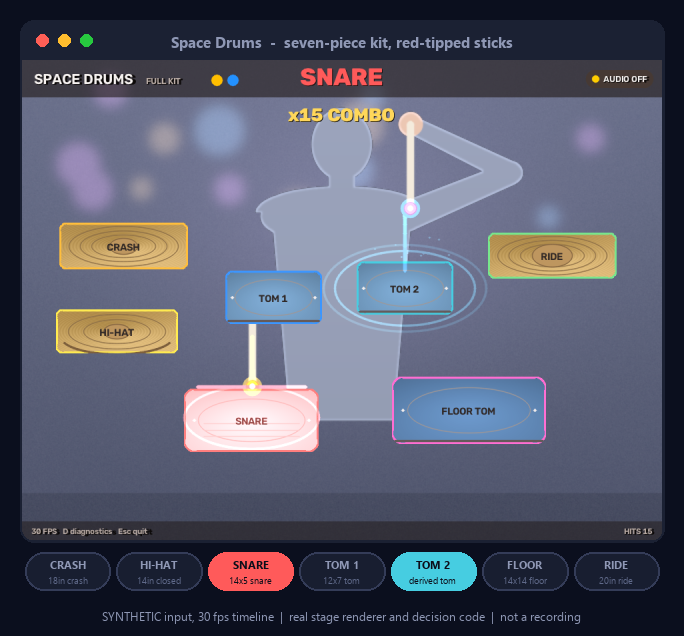<br><sub><b>Product view</b> (synthetic scene, real renderer)</sub></td>
<td align="center" width="50%">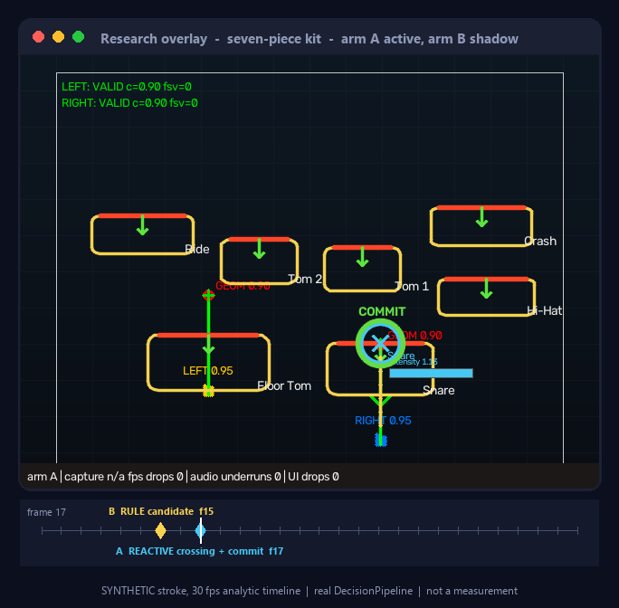<br><sub><b>Research overlay</b> (synthetic stroke, real pipeline)</sub></td>
</tr>
</table>
</div>

<br>

On that synthetic stroke, the rule-based arm's candidate appears **two frames before** the reactive crossing. That demonstrates the *mechanism*; it is an analytic path on a 30 fps timeline, not a measurement of anything a person does.

**Metrics** (defined once in the Phase 09 harness and reused unchanged afterwards): prediction lead time, false-positive and false-negative rates, signed timing error, zone accuracy, trajectory error (ADE / FDE), intensity-proxy agreement, inference latency and a full latency decomposition. Strike intensity is explicitly a *kinematic proxy*, never a force.

**The evaluation design:** about 10 to 12 participants, one or two sessions each, a structured protocol with negatives and fake-outs, participant-level splits and documented labelling rules ([`docs/dataset/`](docs/dataset/), [`docs/protocols/`](docs/protocols/), [`docs/ethics/`](docs/ethics/)). The design is pre-registered and the whole analysis has been rehearsed end to end on synthetic data ([ADR-0042](docs/decisions/ADR-0042-phase18-evaluation-design.md), [ADR-0043](docs/decisions/ADR-0043-ablation-preparation.md)).

### The integrity rules

These come straight from the project requirements and are checked at every gate ([`docs/integrity-checklist.md`](docs/integrity-checklist.md)):

| Label | Meaning |
|---|---|
| **Target** | What we aim for. Never presented as a result. |
| **Measured** | Recorded with a method, a date, a hardware id and a configuration. |
| **Historical** | An earlier measurement that has been superseded. |
| **Pending** | Not measured. Says so, and says why. |

The project must **never** fabricate recordings, dataset samples, accuracy, latency, FPS or real-stick validation; never let a causal component read future frames; and never claim that prediction guarantees sound before the physical impact.

<details>
<summary><b>From the lab notebook: figures that already live in the repository</b></summary>

<br>

<div align="center">
<table>
<tr>
<td align="center" width="33%">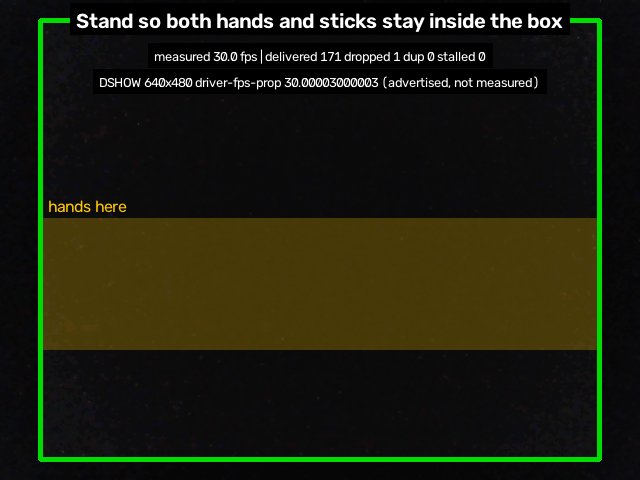<br><sub><b>Real HW-01 capture</b> (Phase 02): the stand-here guide, with the measured capture line. Dark room.</sub></td>
<td align="center" width="33%">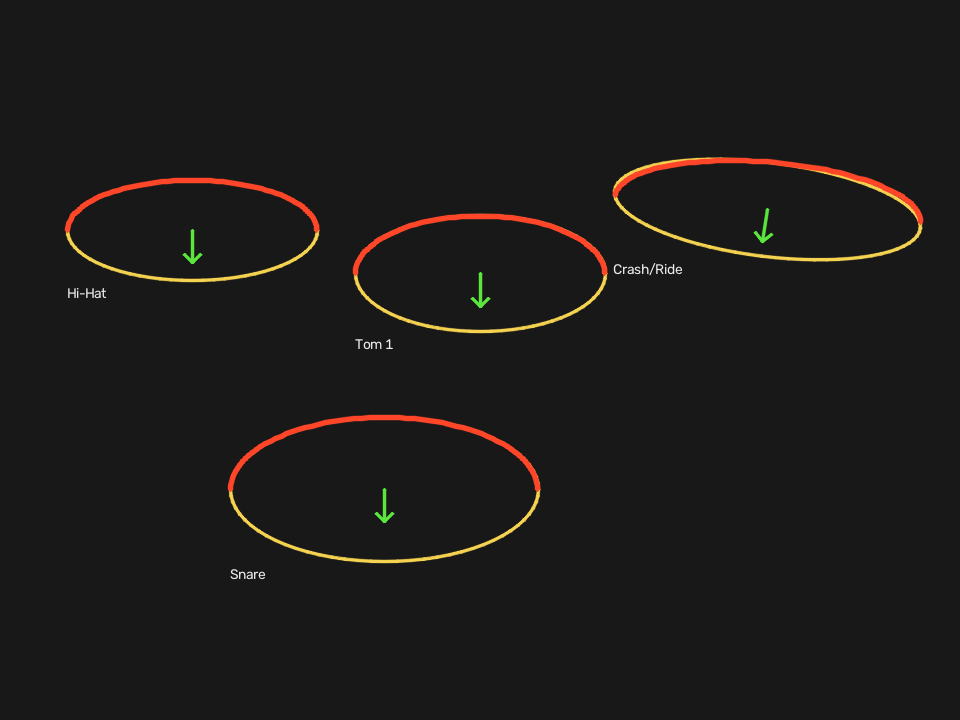<br><sub><b>MVP-4 research layout</b> (Phase 04, synthetic): impact surfaces in red, inward normals in green.</sub></td>
<td align="center" width="33%">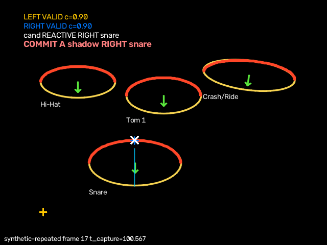<br><sub><b>First playable prototype</b> (Phase 05, synthetic): a candidate and its commit.</sub></td>
</tr>
</table>
</div>

</details>


## Results and limits

The project keeps *what was built* and *what was measured* apart. Everything in the first table is delivered and tested; the evidence column says exactly how far each part was measured.

| Area | Delivered | Evidence |
|---|---|---|
| Capture and timing (P02) | Timestamped capture on one monotonic clock; native 720p capture | 📏 **Measured** on the development laptop: the 640×480 mode delivered 30 FPS; no mode of its webcam delivers 60 FPS. |
| Hands, sticks, tracking (P03) | Hand model, visible-endpoint, fingertip and red-tip estimators, per-hand trackers | Developer recordings and labelled offline benchmarks. |
| Geometry and audio (P04) | Zones, sub-frame crossings, callback mixer, two recorded sample banks | Output latency is the stream's reported value; not measured acoustically. |
| Rule baselines, playable prototype (P05) | Arms A and B | Synthetic and developer strokes. |
| Data, labels, features, GBDT (P06–P09) | Recording pipeline, labelling tools, dataset cards, evaluation harness | Machinery tested on synthetic and developer data. |
| Learned models (P10–P12) | GRU, TCN, multi-task heads, extensions | Trained on synthetic and developer data; none drives the live application. |
| Live integration, calibration, dashboard (P13–P15) | Live loop, automatic calibration, overlay, dashboard, replay viewer | Supervised developer runs (below). |
| Performance, hardening (P16–P17) | Invariants I1–I6, fault injection, soak tests | Tested on synthetic strokes. |
| Evaluation, ablations (P18–P19) | Pre-registered A/B/C design and ablation study | Rehearsed end to end on synthetic data. |
| **The application** (ADR-0045 to ADR-0050) | Three kits, three play modes, classic and AR views | Supervised developer play on the development laptop. |

**Measured live developer evidence** (supervised, development laptop, 2026-10-03; [`docs/reports/standing-product-v1.md`](docs/reports/standing-product-v1.md)):

| | Target | Measured |
|---|---|---|
| Frame rate | 30 FPS | 24.78 FPS over a guided calibration run; 26.19 FPS over a fixed-guide run, idle time included |
| Strike path | All four pads, reliably | Two camera-driven Crash/Ride commits reached the production mixer in that run |
| AR view cost | Small next to the frame budget | 3.4 ms p50 per frame on the laptop's RTX 4050, about 13 ms on its Intel iGPU (synthetic frames; [ADR-0049](docs/decisions/ADR-0049-ar-view-gpu-kit.md)) |

**What this release does not claim.**

- **No latency result.** Action-to-sound latency was not measured externally, and the A/B/C comparison was not run with participants, so the release makes no claim that prediction shortens the effective latency or plays the sound before the impact.
- **No participant data.** No participant recordings were collected; every dataset in the repository is synthetic or from the developer.
- **One machine.** Every measurement comes from one development laptop and its built-in webcam, under Windows 11 with DirectShow capture. Other cameras and platforms are not verified.
- **2-D and single player.** One player, a 2-D camera view, no kick pedal and no MIDI output. Stick identity through crossed sticks is not validated.
- **Developer-tuned layouts.** The seven-piece layout and the red-tip settings are tuned on developer sessions, not on a population of players.

<br>

<div align="center">
</div>


## Architecture

The code is a stack of layers. A layer may import only from the layers below it, and **seven import contracts** enforce that mechanically ([`.importlinter`](.importlinter), checked by `lint-imports` and by `tests/architecture`).

<div align="center">
</div>

Three rules do the heavy lifting: **`prediction` may not import `geometry`** (a model cannot peek at the zones), **`commit` sees only `StrikeCandidate` and `TrackState`** (never perception or features), and **no causal stage may import the offline labelling code**. The views (stage and AR) read only committed strikes and endpoint evidence; they can never create a hit.

<details>
<summary><b>Repository layout</b></summary>

<br>

```text
.
├── src/spacedrums/          the package (≈ 47 k lines)
│   ├── app/                 composition root: play, main, calibrate, pipeline, recorder, health, invariants
│   ├── capture/ hands/ stick/ tracking/      perception and state (stick ends, fingertips, red tips)
│   ├── features/ prediction/ models/         kinematics, rule-based arms, GBDT / GRU / TCN
│   ├── geometry/ commit/ audio/              kits and crossings, commit policy, sample mixer
│   ├── ui/                  kit and stage views, AR view (ui/ar), overlay, dashboard, layout preview
│   ├── calib/ eval/ data/                    calibration, harness, recording
│   ├── live_eval/ ablation/                  confirmatory analysis, ablation study
│   └── contracts/ timing/ config/            records, the one clock, configuration
├── configs/                 versioned YAML: product, demo kits, prototype, zones, camera, calibration
├── schemas/                 JSON Schemas for every record type and the experiment log
├── assets/                  hash-pinned model manifests and the sample-bank manifests
├── scripts/                 tools: fetch assets, measure, verify phases, render figures
├── tests/                   {{TESTS}} tests in 28 suites
├── docs/                    architecture, ADRs, gates, reports, protocols, ethics, user guides
├── phases/                  the 20 phase documents (00 to 19)
├── data/ experiments/       local recordings and run outputs (git-ignored)
├── fingers.bat  sticks.bat  one-click seven-piece kit in the AR view
└── *.ps1                    play, play-ar, demo and demo-sticks launchers
```

</details>


## Quality

```powershell
.\.venv\Scripts\python.exe -m pytest              # {{PYTEST_LINE}}
.\.venv\Scripts\lint-imports                      # 7 import contracts: kept, 0 broken
.\.venv\Scripts\python.exe -m ruff check src tests scripts
```

{{QUALITY_NOTE}}

- **Tests** cover contracts, causality (future-perturbation invariance), parity between offline replay and the live loop, failure injection, runtime invariants, geometry, audio, calibration, the red-tip tracker, the AR scene solver and the UI renderers.
- **Decisions are written down.** 50 ADRs record every choice that was not in the requirements, including the ones that went against a pre-declared rule.
- **Every phase ends at a gate.** The gate record names the evidence, the open conditions and the owner's decision; code existing is never enough to pass.
- **Synthetic data is labelled** as such in file names, documents and pictures, including every animation on this page.


## Documentation map

| Read | To learn |
|---|---|
| [`project-discovery.md`](project-discovery.md) | The 60 owner-confirmed requirements and the scope rules |
| [`phases/README.md`](phases/README.md) | Status vocabulary, timestamp and latency taxonomy, metric definitions |
| [`docs/user/standing-product.md`](docs/user/standing-product.md) | Running the application: calibrated play, the AR view and its controls |
| [`src/spacedrums/ui/README.md`](src/spacedrums/ui/README.md) | The views: stage, kit, AR, diagnostic overlay, layout preview |
| [`docs/user/calibration.md`](docs/user/calibration.md) · [`debug-overlay.md`](docs/user/debug-overlay.md) | The wizard, the overlay, the dashboard and the replay viewer |
| [`docs/architecture/`](docs/architecture/architecture.md) | Module map, layering, record contracts, causality tests |
| [`docs/decisions/`](docs/decisions/README.md) | The 50 architecture decision records |
| [`docs/reports/standing-product-v1.md`](docs/reports/standing-product-v1.md) | The live developer evidence and its limits |
| [`docs/perf/`](docs/perf/) · [`docs/testing/`](docs/testing/README.md) | Profiling reports (camera, brightness, red tips, live FPS), the test matrix and the failure catalogue |
| [`docs/ui-prototype/ar-view.html`](docs/ui-prototype/ar-view.html) | The clickable AR-view design prototype (open it in a browser) |
| [`docs/gates/`](docs/gates/gate-procedure.md) | One gate record per phase |
| [`docs/integrity-checklist.md`](docs/integrity-checklist.md) | The twelve integrity rules |
| [`docs/environment.md`](docs/environment.md) · [`hardware-inventory.md`](docs/hardware-inventory.md) | Locked environment and the reference laptop (HW-01) |
| [`docs/dataset/`](docs/dataset/) · [`docs/protocols/`](docs/protocols/) · [`docs/ethics/`](docs/ethics/) | Dataset cards, recording protocols, consent material |
| [`assets/samples/LICENSES.md`](assets/samples/LICENSES.md) | Where every drum sample comes from, and its licence |

<details>
<summary><b>FAQ</b></summary>

<br>

**Does it need special drumsticks?** No. Bare fingertips and ordinary sticks both work. Red-painted tips are an optional mode that tracks the tips by colour; it is labelled as a marker condition wherever it is used.

**Will the sound play before I hit the pad?** That is the research question, and it is **not claimed**. The commit can come earlier than the observed impact only if prediction works; whether that shortens the effective latency is what the Phase 18 design measures, with audio output latency measured externally.

**The AR view did not appear. Why?** It needs `moderngl` and an OpenGL 3.3 driver. Without either, the app prints one line and continues in the classic view. See [Troubleshooting](#run-it).

**Why is the picture mirrored?** So that it behaves like a mirror. Only the camera image is mirrored; every coordinate used for decisions stays in camera space.

**Why only Windows and Python 3.11?** That is the verified environment (DirectShow capture, locked wheels for MediaPipe and PyTorch). Other platforms are not verified.

**Can I use a phone or an external camera?** Any camera Windows sees can be chosen with `--camera-index` or the AR camera menu, but every measurement in this repository is from the built-in webcam of the development laptop.

**Where are the recordings?** Not in the repository. `data/` and `experiments/` are git-ignored on purpose; the manifests and split files are tracked.

</details>

<details id="how-these-pictures-were-made">
<summary><b>How these pictures were made</b></summary>

<br>

- `scripts/make_readme_assets.py` runs the project's real code on synthetic input, always on the seven-piece kit as `configs/demo.fullkit.candidate.yaml` places it. The fingertip animation scripts sixteen strokes and reads them with the real fingertip estimator (as `app.play --demo --kit full --fingers`). The stick animation draws sticks with red-painted caps and finds them with the real red-tip detector and tracker (as `--red-tips`). (The plain-stick estimator is not used for the pictures: on these synthetic frames it loses the tip wherever a stick crosses the body.) The setup flow runs the real layout preview with scripted key presses. Every frame goes through the real decision pipeline and is drawn by the real `StageRenderer`. The research overlay runs the analytic scenario `alternating_two_zones` on the seven-piece kit's zones with arm A active and arm B in shadow. Only the MediaPipe hand model is replaced by synthetic landmarks, as in `tests/product`.
- `scripts/make_readme_svgs.py` writes the animated SVGs (SMIL and CSS only, no scripts or external files). The concept figures say so inside the picture: they are illustrations, not data. The hero and the kit figure read the pad layout from the kit's config, and the waveforms are read from the recorded acoustic sample files.
- `scripts/make_ar_ui_concept.py` and `scripts/make_ar_ui_prototype.py` build the AR design reference and its clickable prototype from the owner's concept render.

```powershell
.\.venv\Scripts\python.exe scripts\make_readme_assets.py
.\.venv\Scripts\python.exe scripts\make_readme_svgs.py
```

Output goes to [`docs/assets/readme/`](docs/assets/readme/). Both scripts are deterministic: regenerating produces byte-identical files.

</details>

## Contributing

This is an academic project with a strict evidence policy, so the ground rules are short: keep `pytest` and `lint-imports` green; never let a causal component read future frames; label every number **Target**, **Measured**, **Historical** or **Pending**; and never commit recordings or participant data. Please discuss a change with the project owner before sending one.

## Acknowledgements and licences

- **Hand and pose landmarks:** [MediaPipe](https://developers.google.com/mediapipe) Hand Landmarker (Apache-2.0, per [`assets/README.md`](assets/README.md)) and Pose Landmarker models, pinned by SHA-256 in [`assets/models/manifest.json`](assets/models/manifest.json). Check the upstream model cards before redistributing the binaries.
- **Acoustic drum samples:** *"The Salamander Drumkit"* by **Alexander Holm**, [CC BY-SA 3.0](https://creativecommons.org/licenses/by-sa/3.0/), processed by Space Drums (recipe `sal-v1`). The processed WAVs are adaptations and carry the same licence; provenance and hashes in [`acoustic-manifest.json`](assets/samples/acoustic-manifest.json) and [`LICENSES.md`](assets/samples/LICENSES.md).
- **Drum-machine samples:** seven recordings of the Roland TR-505 from the [Oramics Sampled collection](https://oramics.github.io/sampled/DM/TR-505/), labelled *Public Domain* there; hashes in [`recorded-manifest.json`](assets/samples/recorded-manifest.json). The synthetic test bank is generated by a script and dedicated to the public domain (CC0 1.0).
- **Libraries:** OpenCV, NumPy, SciPy, PyTorch, LightGBM, moderngl, Pillow, PyArrow, sounddevice (PortAudio), soundfile, PyYAML, jsonschema and Matplotlib, each under its own licence ([`docs/environment.md`](docs/environment.md) lists them).
- **This repository:** proprietary graduation project (see `pyproject.toml`); no open-source licence has been granted.
- **Project owner:** Youssef Fahem Amin. The git history lists every contributor.

<br>

<div align="center">

</div>
